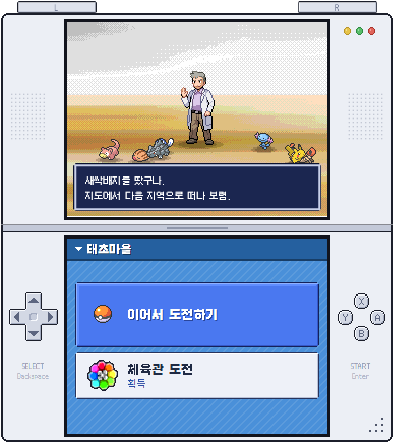
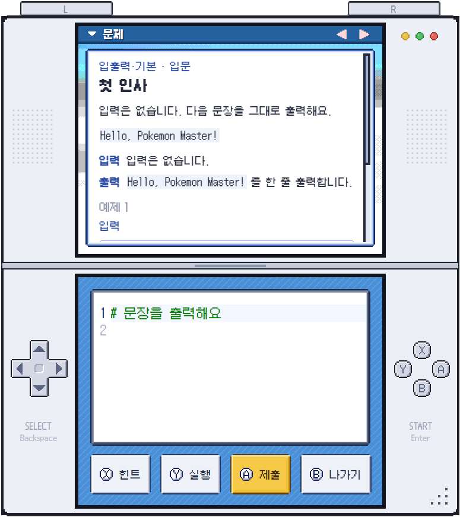
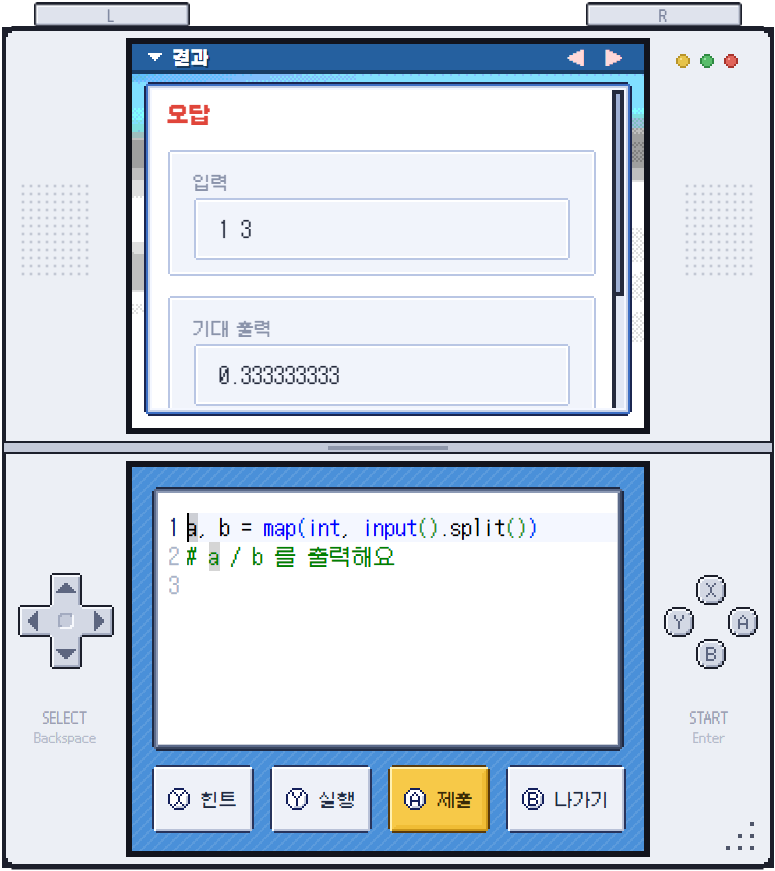
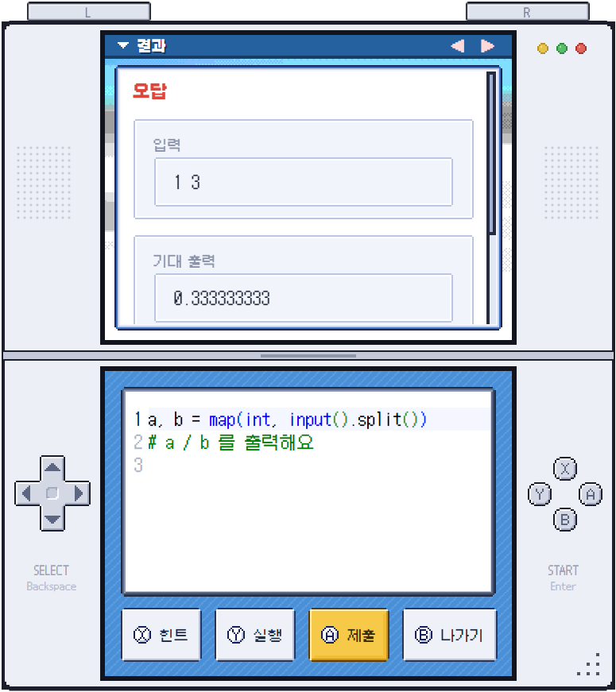
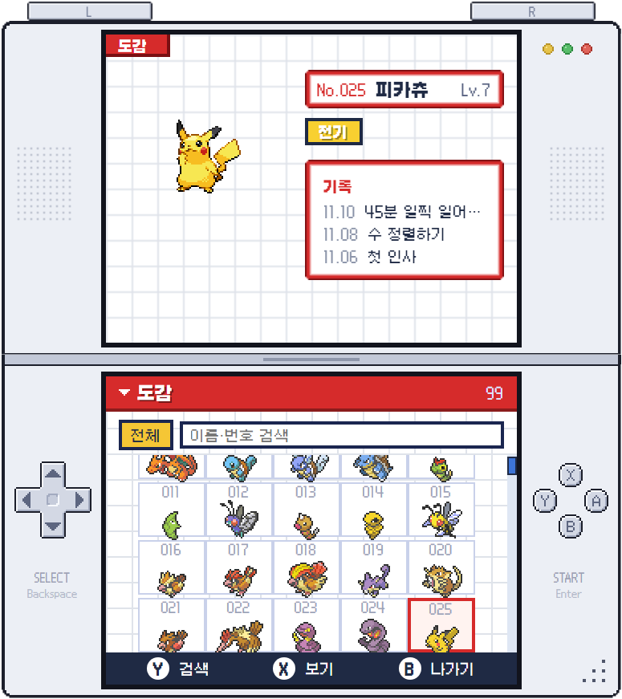
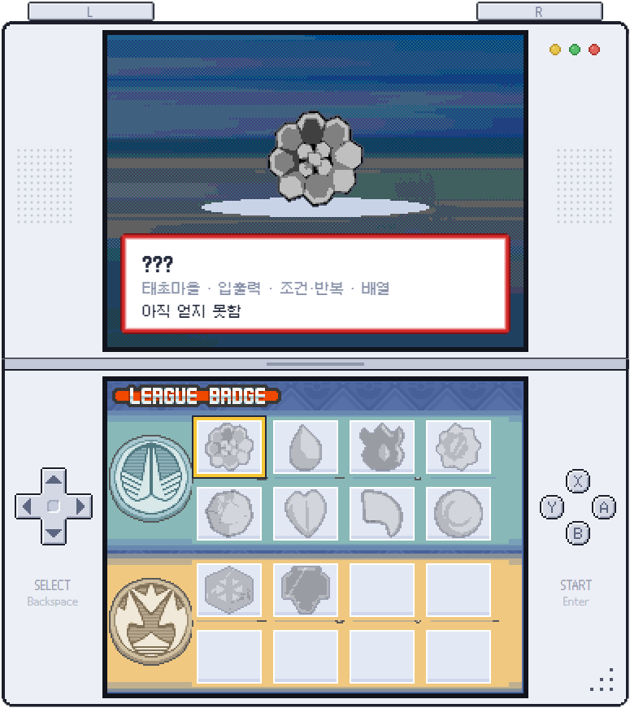

# 오박사의 코테 캠프

닌텐도 DS 포켓몬 스타일의 파이썬 코딩 테스트 연습 앱.
문제를 풀면 포켓몬을 잡고, 도감을 채우고, 체육관 배지를 모은다.

<p>
  
  
  
</p>
<p>
  
  
  
</p>

## 특징

- 정답이면 반드시 포획. 어려운 문제일수록 희귀한 포켓몬
- 5세대까지 649종, 레벨업과 진화
- 오답 시 입력·기대 출력·내 출력을 나란히 비교, 다른 부분 강조
- 풀이 힌트와 문법 힌트를 따로 제공
- 코치가 유형별 실력을 보고 다음 문제 선택 (시간은 보지 않음)
- 10개 지역, 19개 유형, 지역마다 체육관과 배지
- 직접 쓴 문제 30개 + AI가 만드는 문제 (두 풀이가 22개 입력에서 일치해야 채택)

## 실행

```
npm install
npm run sprites
node tools/get-assets.js
npm start
```

Python 3 필요. AI 문제를 쓰려면 `.env`에 `SCHOOL_GATEWAY_API_KEY`를 설정.

## 이미지

도트와 배경은 저작물이라 저장소에 포함하지 않음. 위 두 명령이 내려받는 것 외에 아래는 직접 넣어야 함.

- `assets/ui/scenes/pt-battle-bg.png`
- `assets/ui/scenes/hgss-badgecase.png`
- `assets/ui/badges/<타입>.png`

## 검증

```
npm run verify
npm run verify-algos
```

---

비공식 팬 프로젝트이며 상업적 용도 없음. 포켓몬 관련 자산의 권리는 Nintendo, Game Freak, The Pokémon Company에 있음.
